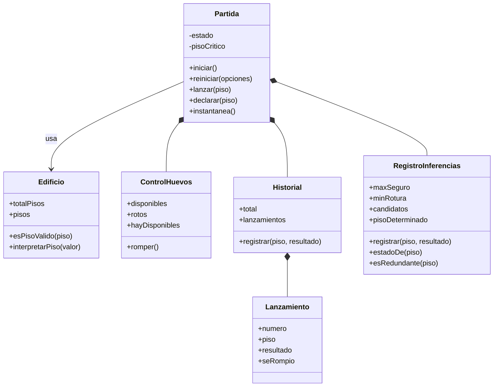
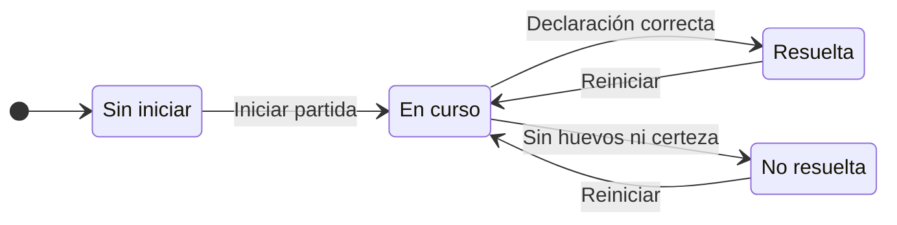

# EGG100 · Prototipo V1 — Simulación básica

Este documento describe todo lo que incluye esta versión del código: la interfaz, la lógica del juego, las validaciones, los mensajes, las pruebas y lo que queda pendiente para V2 y V3.

| Campo | Valor |
| --- | --- |
| Proyecto | EGG100 — Simulador del problema de los dos huevos y los 100 pisos |
| Prototipo | V1 · Simulación básica (Modelo de Prototipos) |
| Código descrito | Rama `main`, commit `b3f16be` (incluye los PR #1 y #2), 21 de octubre de 2026 |
| Versión del paquete | `0.1.0` |
| Requisitos cubiertos | RF-01 a RF-05 y RF-17 a RF-20 |
| Casos de uso | CU-01, CU-02, CU-09, CU-10 y CU-11 |
| Casos de prueba | CP-01 a CP-05 y CP-17 a CP-20 |
| Fuentes | ERS EGG100 v1.0, documento de diseño (diagramas y wireframes) y plan del Modelo de Prototipos |

## 1. Qué hace esta versión

El usuario juega una partida manual para descubrir el **piso crítico F**: el primer piso desde el que un huevo se rompe. Con esta versión puede:

- Iniciar una partida con F elegido al azar entre 1 y 100 y oculto.
- Elegir un piso (con un clic en el edificio o escribiendo el número) y lanzar un huevo.
- Ver en todo momento los huevos disponibles, los intentos, el estado de la partida y el historial de lanzamientos.
- Ver qué pisos son seguros, de rotura o todavía desconocidos. Solo se colorea lo que se deduce de los lanzamientos.
- Recibir un aviso, sin gastar huevos ni intentos, si lanza desde un piso cuyo resultado ya se conoce.
- Declarar F: se acepta solo si es correcto y los lanzamientos lo demuestran.
- Terminar la partida como **resuelta** (declaración correcta) o **no resuelta** (sin huevos y sin certeza).
- Reiniciar la partida, con confirmación si está en curso.

No hay servidor, base de datos, cuentas ni variables de entorno: todo funciona en el navegador. Al recargar la página se pierde la partida en curso.

## 2. Cómo ejecutarla

Requisito: Node.js 22.12 o superior (recomendado 24 LTS).

| Comando | Para qué sirve |
| --- | --- |
| `npm install` | Instala las dependencias |
| `npm run dev` | Inicia la app en modo desarrollo en `http://localhost:5173` |
| `npm run build` | Genera la versión de producción en `dist/` |
| `npm run preview` | Sirve localmente la versión de `dist/` |
| `npm run lint` | Revisa el código con Oxlint |
| `npm test` | Ejecuta las pruebas unitarias (Vitest) |
| `npm run test:watch` | Pruebas unitarias en modo observación |
| `npx playwright install chromium` | Descarga el navegador de pruebas (solo la primera vez) |
| `npm run test:e2e` | Ejecuta las pruebas en el navegador (Playwright) |

## 3. Tecnologías

| Herramienta | Versión | Uso |
| --- | --- | --- |
| React | 19.3 | Interfaz |
| Vite | 8.3 | Servidor de desarrollo y build |
| JavaScript (módulos ES) | — | Lenguaje (sin TypeScript) |
| Vitest | 5.0 | Pruebas unitarias del dominio |
| Playwright | 1.64 | Pruebas de extremo a extremo (E2E) en Chromium |
| Oxlint | 1.89 | Análisis estático, incluidas las reglas de hooks de React |
| GitHub Actions | — | Integración continua en cada PR y en `main` |

No se usan librerías de componentes ni de manejo de estado: solo React y CSS propio.

## 4. Estructura del proyecto

```text
.
├── .github/workflows/ci.yml        # CI: lint, pruebas unitarias, build y E2E
├── docs/prototipo-v1.md            # Este documento
├── public/favicon.svg              # Ícono del huevo
├── src/
│   ├── dominio/                    # Reglas del juego (JS puro, sin React)
│   │   ├── constantes.js           # 100 pisos, piso mínimo 1, 2 huevos
│   │   ├── Edificio.js
│   │   ├── ControlHuevos.js
│   │   ├── Lanzamiento.js
│   │   ├── Historial.js
│   │   ├── RegistroInferencias.js
│   │   ├── generarPisoCritico.js
│   │   ├── Partida.js
│   │   └── *.test.js               # 6 archivos de pruebas unitarias
│   ├── hooks/usePartida.js         # Conecta la clase Partida con React
│   ├── componentes/                # 13 componentes, etiquetas.js y mensajes.js
│   ├── prototipo.js                # Versión visible: «V1 · Simulación básica»
│   ├── App.jsx                     # Elige la pantalla de inicio o la de simulación
│   ├── App.css                     # Estilos de la interfaz
│   ├── index.css                   # Paleta de colores y estilos base
│   └── main.jsx                    # Punto de entrada
├── tests/e2e/v1-simulacion-basica.spec.js   # Pruebas Playwright (CP-xx)
├── index.html                      # Página base (idioma español)
├── playwright.config.js
├── vite.config.js                  # Vite y configuración de Vitest
├── .oxlintrc.json
├── .gitignore
└── package.json
```

### Arquitectura en tres capas

```text
 Componentes (React) --- acción: lanzar, declarar... ---> usePartida ---> Partida (dominio)
        ^                                                     |
        +----------- instantánea inmutable del estado <-------+
```

- **Dominio** (`src/dominio`): todas las reglas del juego, en clases de JavaScript que no dependen de React. Se prueban por separado y se reutilizarán en V2 (estrategias automáticas) y V3 (análisis de los 100 escenarios).
- **Hook** (`usePartida`): crea una `Partida`, ejecuta las acciones y, después de cada una, entrega a React una instantánea inmutable del estado.
- **Componentes** (`src/componentes`): muestran la instantánea y envían acciones. Nunca reciben F mientras la partida está en curso.

## 5. Parte visual

### 5.1 Pantallas y navegación

| Pantalla | Cuándo se ve | Contenido |
| --- | --- | --- |
| Inicio | Al abrir la app | Título, presentación del problema, reglas, pasos para jugar y botón **Iniciar partida** |
| Simulación | Después de pulsar **Iniciar partida** | Edificio, estado y controles, mensaje del resultado, leyenda e historial |

No hay rutas ni URLs distintas: `App.jsx` muestra una u otra pantalla según el estado de la partida. La barra superior indica la pantalla actual entre paréntesis («Inicio» o «Lanzamiento manual») y muestra la etiqueta **Prototipo V1 · Simulación básica**.

### 5.2 Distribución de la pantalla de simulación

La distribución sigue el wireframe «Lanzamiento Manual» del documento de diseño:

```text
+---------------------------------------------------------------------------+
| EGG100 · Simulador de los dos huevos (Lanzamiento manual)  [Prototipo V1] |
+---------------------------------------------------------------------------+
| > ¿Cómo jugar?  (desplegable con las reglas)                              |
+------------------+----------------------------+---------------------------+
| Edificio de      | Estado y lanzamiento       | Leyenda                   |
| 100 pisos        |  Huevos disponibles  2     |  [v] Piso seguro          |
|  +----------+    |  Intentos            0     |  [x] Piso roto            |
|  |   100    |    |  Partida      En curso     |  [ ] Desconocido          |
|  |   ...    |    |  Piso seleccionado [25]    |                           |
|  |    2     |    |  ( Lanzar )                | Historial                 |
|  |    1     |    |  ( Declarar )              |  Intento | Piso | Result. |
|  +----------+    |  ( Reiniciar )             |                           |
| (con scroll)     |  Mensaje del resultado     |                           |
+------------------+----------------------------+---------------------------+
```

- En pantallas de 960 px de ancho o menos, las tres columnas se apilan en una sola.
- El edificio y el historial tienen su propio scroll, así la página no crece con los 100 pisos.
- El desplegable «¿Cómo jugar?» muestra las mismas instrucciones que la pantalla de inicio.

### 5.3 Componentes

Todos están en `src/componentes/`.

| Componente | Qué muestra o hace |
| --- | --- |
| `Encabezado` | Barra superior con el título, la pantalla actual y la etiqueta del prototipo |
| `PantallaInicio` | Presentación, reglas y botón **Iniciar partida** |
| `Instrucciones` | Reglas y pasos para jugar; aparece en el inicio y en el desplegable «¿Cómo jugar?» |
| `PantallaSimulacion` | Organiza la pantalla de juego: guarda el piso seleccionado, el mensaje actual y el diálogo abierto |
| `TorreEdificio` | 100 botones de piso, del 100 (arriba) al 1 (abajo), coloreados según lo deducido; al pulsar uno queda seleccionado |
| `PanelEstado` | Huevos disponibles (íconos y número), intentos, estado de la partida y F (solo cuando la partida terminó) |
| `ControlesLanzamiento` | Campo «Piso seleccionado» y botones **Lanzar**, **Declarar** y **Reiniciar** |
| `MensajeEstado` | Explicación del último resultado, con un color según el tipo de mensaje |
| `Leyenda` | Significado de los colores de la torre |
| `TablaHistorial` | Tabla Intento / Piso / Resultado («Intacto» o «Roto») |
| `Dialogo` | Base de los diálogos: `<dialog>` nativo en modo modal |
| `DialogoDeclarar` | Pide F, precargado con el piso seleccionado; si el valor no es válido, muestra el error dentro del diálogo |
| `DialogoConfirmacion` | Confirmación «¿Reiniciar la partida?» |
| `etiquetas.js` | Textos visibles de los estados: seguro, rotura, desconocido; Sin iniciar, En curso, Resuelta, No resuelta; Intacto, Roto |
| `mensajes.js` | Convierte cada resultado del dominio en un mensaje explicado (ver sección 8) |

### 5.4 Colores y señales visuales

| Elemento | Aspecto |
| --- | --- |
| Piso seguro | Verde `#a7e3ab` (borde `#3f9d4a`) con el símbolo ✓ |
| Piso de rotura | Rojo `#f6a5a5` (borde `#cc4b4b`) con el símbolo ✕ |
| Piso desconocido | Gris `#dde2e8`, sin símbolo |
| Piso seleccionado | Contorno azul interior y número en negrita |
| Huevo disponible | Ícono de huevo color crema |
| Huevo roto | Ícono con borde rojo discontinuo y fondo rayado |
| Botón **Lanzar** | Azul: es la acción principal |
| Botón **Declarar** | Halo verde cuando la evidencia ya determina F |
| Botón **Sí, reiniciar** | Rojo: descarta la partida |
| Botones de acción desactivados | Semitransparentes, con cursor de «no permitido» |
| Columna Resultado del historial | «Intacto» en verde y «Roto» en rojo |
| Barra superior y encabezado de la tabla | Azul oscuro `#2e3a4b` |

Cada mensaje tiene un tono que define su color:

| Tono | Color | Cuándo se usa |
| --- | --- | --- |
| Neutro | Gris | Inicio, reinicio y reinicio cancelado |
| Seguro | Verde claro | El huevo sobrevivió |
| Rotura | Rojo claro | El huevo se rompió |
| Aviso | Amarillo | Intento redundante o falta de evidencia |
| Error | Rojo | Piso no válido, declaración incorrecta o partida no resuelta |
| Éxito | Verde, en negrita | Declaración correcta |

### 5.5 Controles activos según el estado de la partida

| Control | En curso | En curso, sin huevos y con F determinado | Terminada |
| --- | --- | --- | --- |
| Pisos del edificio | Activos | Activos | Desactivados |
| Campo «Piso seleccionado» | Activo | Activo | Desactivado |
| **Lanzar** | Activo | Desactivado | Desactivado |
| **Declarar** | Activo, con halo si F ya está determinado | Activo, con halo | Desactivado |
| **Reiniciar** | Activo; pide confirmación | Activo; pide confirmación | Activo; reinicia sin confirmar |

Quedarse sin huevos sin haber determinado F termina la partida como no resuelta; por eso la columna central solo se da cuando F ya está determinado.

### 5.6 Accesibilidad y usabilidad

- La página está declarada en español (`lang="es"`).
- Cada piso se anuncia como «Piso N, seguro», «Piso N, rotura» o «Piso N, desconocido», y el seleccionado se marca con `aria-pressed`.
- Los estados se distinguen por color **y** por símbolo (✓ / ✕), para no depender solo del color.
- Los mensajes de resultado están en una región `role="status"`, que los lectores de pantalla anuncian. El error del diálogo de declaración usa `role="alert"` y marca el campo con `aria-invalid`.
- Los diálogos son modales nativos: bloquean el resto de la página, se cierran con Escape (equivale a Cancelar) y, al cerrarse, devuelven el foco al botón que los abrió. Si ese botón queda desactivado, como **Declarar** tras una declaración correcta, el foco pasa al cuerpo de la página.
- Pulsar Enter en el campo «Piso seleccionado» equivale a **Lanzar**; en el diálogo de declaración, a **Confirmar**.
- Botones, pisos, campos y el desplegable muestran un contorno azul cuando reciben el foco con el teclado.
- El historial es una tabla con encabezados de columna, y el estado, una lista de definiciones.
- Las instrucciones están siempre a mano en el desplegable «¿Cómo jugar?» (RNF-01).
- Los campos numéricos abren el teclado numérico en el móvil (`inputMode="numeric"`).

## 6. Lógica del juego

### 6.1 Reglas del negocio implementadas

| Regla de la ERS | Cómo se aplica | Dónde |
| --- | --- | --- |
| RN-01 Edificio | 100 pisos numerados del 1 al 100 | `constantes.js`, `Edificio` |
| RN-02 Comportamiento de los huevos | Se rompe si piso ≥ F; sobrevive si piso < F | `determinarResultado` |
| RN-03 Disponibilidad de huevos | Dos huevos; el que sobrevive se reutiliza y el roto no | `ControlHuevos` |
| RN-04 y RN-10 Objetivo y declaración | F se acepta cuando la evidencia deja un único piso posible; el piso seguro máximo puede ser 0 | `RegistroInferencias`, `Partida.declarar` |
| RN-07 Inicialización | F aleatorio en [1, 100] y oculto, 2 huevos y 0 intentos | `generarPisoCriticoAleatorio`, `Partida.iniciar` |
| RN-08 Estados inferidos | Sobrevivir en x vuelve seguros los pisos 1 a x; romperse en x vuelve de rotura los pisos x a 100 | `RegistroInferencias` |
| RN-09 Intento redundante | No se lanza, no cuenta y se avisa | `Partida.lanzar` |
| RN-11 Fin de partida | Resuelta al declarar F correctamente; no resuelta si se acaban los huevos sin certeza; después no se permiten lanzamientos | `Partida.lanzar`, `Partida.declarar` |
| RN-12 Reinicio | Nuevo F y todo vuelve al estado inicial; si la partida está en curso, pide confirmación | `Partida.reiniciar` |

RN-05, RN-06 y RN-13 (criterio de optimización, límite de 14 lanzamientos y saltos fijos) corresponden a V2 y V3.

### 6.2 Clases del dominio



Todos los archivos están en `src/dominio/`.

| Clase o módulo | Archivo | Responsabilidad | Miembros principales |
| --- | --- | --- | --- |
| `Edificio` | `Edificio.js` | Pisos del 1 al 100 y validación del piso elegido | `totalPisos`, `pisos`, `esPisoValido()`, `interpretarPiso()` |
| `ControlHuevos` | `ControlHuevos.js` | Huevos disponibles; un huevo roto no vuelve | `disponibles`, `rotos`, `hayDisponibles`, `romper()` |
| `Lanzamiento` y `determinarResultado` | `Lanzamiento.js` | Regla de rotura y registro inmutable de un intento | `numero`, `piso`, `resultado`, `seRompio` |
| `Historial` | `Historial.js` | Intentos numerados 1, 2, 3… sin saltos ni duplicados | `registrar()`, `total`, `lanzamientos` |
| `RegistroInferencias` | `RegistroInferencias.js` | Lo que se deduce de los lanzamientos; no conoce F | `maxSeguro`, `minRotura`, `estadoDe()`, `esRedundante()`, `candidatos`, `pisoDeterminado` |
| `generarPisoCriticoAleatorio` | `generarPisoCritico.js` | F aleatorio uniforme entre 1 y 100 | Recibe la función de azar (por defecto `Math.random`) para poder fijarla en las pruebas |
| `Partida` | `Partida.js` | Coordina todo: estado, F, acciones y fin de partida | `iniciar()`, `reiniciar()`, `lanzar()`, `declarar()`, `instantanea()` |
| Constantes | `constantes.js` | Parámetros del problema | `TOTAL_PISOS = 100`, `PISO_MINIMO = 1`, `HUEVOS_INICIALES = 2` |

Puntos importantes del diseño:

- `lanzar()` y `declarar()` devuelven un objeto con un **tipo** de resultado y los datos necesarios para explicarlo; `reiniciar()` indica si se reinició o si falta confirmar. Una entrada incorrecta del usuario nunca produce un error de JavaScript.
- `intentos` se calcula como el tamaño del historial, así el contador y el historial no pueden desincronizarse.
- `Lanzamiento` es inmutable. `instantanea()` devuelve un objeto congelado con copias de los datos y `Historial.lanzamientos` también devuelve una copia, así que la interfaz no puede alterar la partida a través de ellos.
- `pisoCriticoRevelado` vale `null` mientras la partida está en curso y F cuando termina.

| Acción | Tipos de resultado posibles |
| --- | --- |
| `lanzar(piso)` | `realizado`, `piso_invalido`, `sin_huevos`, `redundante`, `partida_inactiva` |
| `declarar(piso)` | `correcta`, `incorrecta`, `sin_evidencia`, `piso_invalido`, `partida_inactiva` |
| `reiniciar({ confirmado })` | `{ reiniciada: true }` o `{ reiniciada: false, requiereConfirmacion: true }` |

### 6.3 Estados de la partida



Mientras la partida está en curso, lanzar o declarar sin éxito no cambia el estado, y reiniciar con confirmación empieza otra partida en curso.

| Estado | Significado |
| --- | --- |
| Sin iniciar | Antes de pulsar **Iniciar partida**; se ve la pantalla de inicio |
| En curso | Se puede lanzar (si quedan huevos), declarar y reiniciar con confirmación |
| Resuelta | Se declaró F correctamente y con evidencia; se muestra F |
| No resuelta | Se rompió el último huevo sin poder determinar F; se muestra F |

### 6.4 Qué pasa al lanzar

`Partida.lanzar(piso)` revisa en este orden, como el diagrama de actividad del lanzamiento manual (D3):

1. Si la partida no está en curso → `partida_inactiva`.
2. Si el piso no es un entero entre 1 y 100 → `piso_invalido`.
3. Si no quedan huevos → `sin_huevos`.
4. Si el resultado de ese piso ya se conoce → `redundante`.
5. Se aplica la regla: el huevo se rompe si piso ≥ F.
6. Si se rompió, se descuenta un huevo.
7. Se actualizan las inferencias y se registra el intento en el historial; el contador sube en 1.
8. Si no quedan huevos y F no está determinado, la partida termina como **no resuelta** y se revela F.

Los pasos 1 a 4 no modifican nada: ni huevos, ni contador, ni historial.

### 6.5 Qué pasa al declarar

`Partida.declarar(piso)`:

1. Si la partida no está en curso → `partida_inactiva`.
2. Si el piso no es un entero entre 1 y 100 → `piso_invalido`. El diálogo sigue abierto y muestra el error.
3. Se calculan los candidatos a F: desde el piso seguro más alto + 1 hasta el piso de rotura más bajo (o 100 si ningún huevo se rompió).
4. Si el piso declarado está entre los candidatos pero todavía hay más de uno → `sin_evidencia`. Esto se revisa **antes** de comparar con F, para que declarar al azar no revele si se acertó.
5. Si es el único candidato, es F → `correcta`, y la partida queda **resuelta**.
6. Si el piso contradice la evidencia → `incorrecta`: se explica por qué y la partida continúa.

Las respuestas de los pasos 4 a 6 incluyen la evidencia (piso seguro más alto, rotura más baja y rango de candidatos), los intentos y los huevos, que `mensajes.js` usa para explicar el resultado.

### 6.6 Qué pasa al reiniciar

- Con la partida en curso, `reiniciar()` no cambia nada y pide confirmación. **Sí, reiniciar** empieza una partida nueva; **Cancelar** o Escape dejan todo igual.
- Con la partida terminada, se reinicia directamente.
- Al reiniciar se genera otro F, vuelven los 2 huevos, el contador queda en 0, el historial se vacía, todos los pisos pasan a desconocidos y se limpia el piso seleccionado.

### 6.7 Cómo se deducen los pisos

`RegistroInferencias` solo guarda dos datos: el piso seguro más alto (empieza en 0) y el piso de rotura más bajo (empieza vacío). Con ellos calcula:

- **Estado de un piso:** seguro si es menor o igual que el piso seguro más alto; de rotura si es mayor o igual que la rotura más baja; si no, desconocido.
- **Candidatos a F:** desde el piso seguro más alto + 1 hasta la rotura más baja (o 100 si no hay roturas).
- **F determinado:** cuando queda un único candidato.

Ejemplo de una partida con F = 40:

| Paso | Piso | Resultado | Seguros | Rotura | Candidatos a F | Huevos | Intentos |
| --- | --- | --- | --- | --- | --- | --- | --- |
| 1 | 30 | Sobrevive | 1–30 | — | 31–100 | 2 | 1 |
| 2 | 20 | Redundante: ya es seguro, no se lanza | 1–30 | — | 31–100 | 2 | 1 |
| 3 | 60 | Se rompe | 1–30 | 60–100 | 31–60 | 1 | 2 |
| 4 | 39 | Sobrevive | 1–39 | 60–100 | 40–60 | 1 | 3 |
| 5 | 40 | Se rompe | 1–39 | 40–100 | Solo 40: F determinado | 0 | 4 |

Tras el paso 5 no quedan huevos, pero F ya está determinado: **Lanzar** se desactiva, **Declarar** se resalta en verde y, al declarar 40, la partida queda resuelta en 4 intentos.

Casos especiales:

- **F = 1:** si el huevo se rompe en el piso 1, F = 1 queda demostrado y el piso seguro más alto es 0.
- **F = 100:** si el huevo sobrevive en el piso 99, F = 100 queda determinado y se puede declarar, aunque el piso 100 sigue gris (ver sección 11).

### 6.8 Conexión con React

`usePartida` crea una única `Partida` cuando se abre la app. Cada acción (`iniciar`, `lanzar`, `declarar` y `reiniciar`) llama al dominio, guarda la nueva instantánea en el estado de React, lo que vuelve a dibujar la pantalla, y devuelve el resultado para que `PantallaSimulacion` elija el mensaje. Los componentes nunca modifican la partida directamente.

## 7. Validaciones

### 7.1 Qué se valida

| Qué se valida | Regla | Dónde | Qué ve el usuario |
| --- | --- | --- | --- |
| Piso a lanzar | Entero entre 1 y 100 | `Edificio.interpretarPiso`, `Partida.lanzar` | “Piso no válido: elige un número entero entre 1 y 100.” No cambia nada |
| Huevos disponibles | No se lanza con 0 huevos | Botón **Lanzar** desactivado; `Partida.lanzar` también lo rechaza | **Lanzar** desactivado. El mensaje del dominio («No quedan huevos…») no llega a verse en la interfaz |
| Intento redundante | El piso ya es seguro o de rotura | `RegistroInferencias.esRedundante` | Aviso; no cambian huevos, contador ni historial |
| Partida activa | Solo se lanza o declara con la partida en curso | Controles desactivados; `Partida.lanzar` y `declarar` también lo rechazan | Controles desactivados. El mensaje del dominio («La partida ya terminó…») no llega a verse en la interfaz |
| Piso declarado | Entero entre 1 y 100 | `Partida.declarar` | “Escribe un piso entero entre 1 y 100.” dentro del diálogo, que sigue abierto |
| Evidencia suficiente | Debe quedar un único candidato a F | `Partida.declarar` | “Aún no hay evidencia suficiente…” con el rango de candidatos |
| Declaración coherente | El piso debe estar entre los candidatos | `Partida.declarar` | “Declaración incorrecta: …” con el motivo |
| Reinicio | Confirmación si la partida está en curso | `Partida.reiniciar`, `DialogoConfirmacion` | Diálogo «¿Reiniciar la partida?» |
| F generado | Debe estar entre 1 y 100 | `Partida.iniciar` | Error interno (`RangeError`) que protege el código |
| Tamaño del edificio | Entero mayor o igual que 1 | Constructor de `Edificio` | Error interno (`RangeError`) que protege el código |

### 7.2 Pisos aceptados y rechazados

| Entrada | Resultado |
| --- | --- |
| `1`, `40`, `100` | Válida |
| Texto `"7"` o `" 7 "` | Válida: piso 7 (se ignoran los espacios) |
| `0`, `101`, `-3` | Rechazada: fuera del rango 1–100 |
| `2.5` | Rechazada: no es un entero |
| `1e2` | Rechazada: solo se aceptan dígitos |
| `10a`, `abc` | Rechazada: no es un número |
| Campo vacío | Rechazada |

### 7.3 Dónde se valida

- Todas las reglas las aplica el dominio. Los formularios usan `noValidate`, así el navegador no muestra sus propios globos de error y el mensaje siempre es el mismo.
- La interfaz además desactiva **Lanzar** cuando no quedan huevos y los controles cuando la partida termina; el dominio rechaza esas acciones igualmente.
- Los atributos `min`, `max` y `step` solo guían las flechas del campo (botones y teclas ↑/↓); no impiden escribir otros valores.

### 7.4 Protección del piso crítico

- F no está en la instantánea que recibe la interfaz mientras la partida está en curso.
- La torre y la leyenda solo muestran lo que se deduce de los lanzamientos.
- La falta de evidencia se comprueba antes de comparar con F.
- F se muestra solo cuando la partida termina.
- No es un mecanismo de seguridad: F está en la memoria del navegador. El objetivo es que la interfaz no lo revele.

## 8. Mensajes al usuario

Estos son mensajes reales generados por el código. Salen de la partida con F = 40 de la sección 6.7, con algunas declaraciones y entradas inválidas intercaladas. La excepción es el mensaje de partida no resuelta, que sale de otra partida con F = 40 (lanzamientos en los pisos 50 y 45).

| Situación | Mensaje | Tono |
| --- | --- | --- |
| Partida iniciada | Partida iniciada. Selecciona un piso y pulsa «Lanzar». | Neutro |
| El huevo sobrevive | Intento 1: el huevo sobrevivió en el piso 30. Los pisos 1 a 30 son seguros. | Seguro |
| Intento redundante | Intento redundante: ya se sabe que el piso 20 es seguro (el huevo sobreviviría). No se contó el intento ni se usó un huevo. | Aviso |
| Declaración sin evidencia | Aún no hay evidencia suficiente: con tus lanzamientos, F puede ser cualquier piso entre 31 y 100. Sigue lanzando para reducir los candidatos. | Aviso |
| Declaración incorrecta (piso seguro) | Declaración incorrecta: el huevo sobrevivió en el piso 30, así que el piso 25 es seguro y no puede ser F. Puedes seguir buscando. | Error |
| El huevo se rompe | Intento 2: el huevo se rompió en el piso 60. Los pisos 60 a 100 son de rotura. Te queda 1 huevo. | Rotura |
| Declaración incorrecta (por encima de una rotura) | Declaración incorrecta: el huevo se rompió en el piso 60, así que F no puede ser mayor que 60. Puedes seguir buscando. | Error |
| Se rompe el último huevo y F queda determinado | Intento 4: el huevo se rompió en el piso 40. Los pisos 40 a 100 son de rotura. No quedan huevos. La evidencia ya determina un único piso crítico: pulsa «Declarar». | Rotura |
| Lanzar sin huevos (no llega a verse en la interfaz: **Lanzar** está desactivado) | No quedan huevos, así que ya no se permiten lanzamientos. La evidencia determina F: pulsa «Declarar». | Aviso |
| Declaración correcta | ¡Correcto! El piso crítico es 40: el huevo sobrevivió en el piso 39 y se rompió en el piso 40. Lo demostraste en 4 intentos. | Éxito |
| Partida no resuelta | Intento 2: el huevo se rompió en el piso 45. Los pisos 45 a 100 son de rotura. No quedan huevos. La evidencia no basta para determinar F (podía estar entre los pisos 1 y 45). Partida no resuelta: el piso crítico era 40. | Error |
| Piso a lanzar no válido | Piso no válido: elige un número entero entre 1 y 100. | Error |
| Piso declarado no válido (dentro del diálogo) | Escribe un piso entero entre 1 y 100. | Error |
| Reinicio | Partida reiniciada con un nuevo piso crítico oculto. Selecciona un piso y pulsa «Lanzar». | Neutro |
| Reinicio cancelado | Reinicio cancelado: la partida continúa sin cambios. | Neutro |
| Acción con la partida terminada (no llega a verse en la interfaz: los controles están desactivados) | La partida ya terminó. Pulsa «Reiniciar» para jugar otra vez. | Aviso |

Otras variantes:

- **F = 1:** “¡Correcto! El piso crítico es 1: el huevo se rompió en el piso 1, así que no hay pisos seguros (el piso seguro máximo es 0). Lo demostraste en 1 intento.”
- **F = 100:** “¡Correcto! El piso crítico es 100: el huevo sobrevivió en el piso 99 y F no puede ser mayor que 100. Lo demostraste en 1 intento.”
- Una declaración incorrecta sin huevos termina con “Revisa la torre y vuelve a declarar.” en lugar de “Puedes seguir buscando.”.
- Los textos respetan singular y plural: «Te queda 1 huevo», «Lo demostraste en 1 intento».

## 9. Pruebas automatizadas

### 9.1 Pruebas unitarias (Vitest)

Son 52 pruebas, en `src/dominio/`:

| Archivo | Pruebas | Qué comprueban |
| --- | --- | --- |
| `Edificio.test.js` | 17 | 100 pisos numerados (CP-01); acepta del 1 al 100 y rechaza 13 entradas inválidas (CP-02); interpreta texto; no admite edificios sin pisos |
| `ControlHuevos.test.js` | 3 | Empieza con 2 huevos; cada rotura descuenta uno (CP-04); no se rompen más huevos de los disponibles |
| `Historial.test.js` | 2 | Numeración consecutiva; el historial no se puede alterar desde fuera |
| `RegistroInferencias.test.js` | 8 | Seguros, rotura y desconocidos (CP-19); redundancia (CP-20); candidatos; F determinado; casos F = 1 y F = 100 |
| `generarPisoCritico.test.js` | 2 | Reparto del azar entre 1 y 100; siempre un entero válido (1000 muestras) |
| `Partida.test.js` | 20 | Inicio (CP-17); regla de rotura para los 100 valores de F por los 100 pisos (CP-03); rango (CP-02); huevos y contador (CP-04, CP-05); inferencias y redundancia (CP-19, CP-20); declaración correcta, incorrecta, sin evidencia y no resuelta (CP-18); reinicio con y sin confirmación (CP-17) |

### 9.2 Pruebas en el navegador (Playwright)

Son 6 pruebas, en `tests/e2e/v1-simulacion-basica.spec.js`. Se ejecutan en Chromium de escritorio sobre la versión compilada (`npm run build` y `npm run preview`):

| Prueba | Qué comprueba |
| --- | --- |
| CP-01, CP-02, CP-19 | 100 pisos (el 100 arriba y el 1 abajo), todos desconocidos y sin mostrar F; selección de un piso con clic; 0 y 101 se rechazan sin gastar huevos ni intentos |
| CP-03, CP-04, CP-05, CP-19 | Un lanzamiento que sobrevive y otro que se rompe: mensajes, huevos, intentos, colores de la torre e historial |
| CP-20 | Un intento redundante muestra el aviso y no cambia huevos, intentos ni historial |
| CP-18 (declaración) | Declaración sin evidencia, incorrecta y correcta; el foco vuelve a **Declarar**; al resolver se muestra F y se desactivan **Lanzar** y **Declarar** |
| CP-18 (no resuelta) | Sin huevos y sin certeza: estado «No resuelta», se muestra F y se desactivan los controles |
| CP-17 | Reiniciar pide confirmación; **Cancelar** y Escape conservan la partida y devuelven el foco; confirmar lo restablece todo |

Para conocer F sin mostrarlo en la interfaz, cada prueba fija `Math.random` antes de cargar la página.

### 9.3 Integración continua (GitHub Actions)

`.github/workflows/ci.yml` se ejecuta en cada pull request y en cada push a `main`, en Ubuntu con Node 24:

1. `npm ci`
2. `npm run lint`
3. `npm test`
4. `npm run build`
5. Instala Chromium y ejecuta `npm run test:e2e`
6. Publica el reporte de Playwright como artefacto, que se conserva 14 días

El workflow solo tiene permiso de lectura sobre el repositorio y no usa secretos.

### 9.4 Último resultado verificado

Sobre el commit `b3f16be`, el 21 de octubre de 2026:

| Revisión | Resultado |
| --- | --- |
| Lint (Oxlint) | 0 avisos y 0 errores |
| Pruebas unitarias | 52 de 52 |
| Pruebas E2E | 6 de 6 en Chromium |
| Build | Correcto |
| CI en GitHub | En verde en los PR #1 y #2 y en `main` |

## 10. Trazabilidad de V1

| Requisito | Caso de uso | Implementación | Prueba |
| --- | --- | --- | --- |
| RF-01 Visualización del edificio | CU-02 | `Edificio`, `TorreEdificio` | CP-01 |
| RF-02 Selección del piso | CU-01 | `Edificio.interpretarPiso`, `TorreEdificio`, `ControlesLanzamiento` | CP-02 |
| RF-03 Simulación del lanzamiento | CU-01 | `determinarResultado`, `Partida.lanzar` | CP-03 |
| RF-04 Control de huevos disponibles | CU-01, CU-02 | `ControlHuevos`, `PanelEstado` | CP-04 |
| RF-05 Contador de lanzamientos | CU-01, CU-02 | `Historial`, `Partida.intentos`, `PanelEstado` | CP-05 |
| RF-17 Iniciar y reiniciar partida | CU-09 | `Partida.iniciar` y `reiniciar`, `DialogoConfirmacion` | CP-17 |
| RF-18 Declarar resultado y finalizar | CU-10 | `Partida.declarar`, `DialogoDeclarar`, `mensajes.js` | CP-18 |
| RF-19 Información inferida | CU-11 | `RegistroInferencias`, `TorreEdificio`, `Leyenda` | CP-19 |
| RF-20 Evitar intentos redundantes | CU-11 | `RegistroInferencias.esRedundante`, `Partida.lanzar` | CP-20 |

## 11. Decisiones por validar con el cliente

Comportamientos que la ERS no fija del todo y que conviene revisar en la evaluación de V1:

1. **Declarar sin evidencia no revela F.** Mientras haya varios pisos posibles, la respuesta es «no hay evidencia suficiente», coincida o no con F. El diagrama D4 compara primero con F, lo que permitiría descubrirlo declarando al azar.
2. **Fin automático sin huevos.** Si se rompe el último huevo y F no está determinado, la partida termina como no resuelta (RN-11) y se muestra F.
3. **Sin huevos, pero con F determinado:** se bloquean los lanzamientos y se puede declarar.
4. **Reinicio:** pide confirmación siempre que la partida esté en curso, aunque todavía no haya lanzamientos; una partida terminada se reinicia sin confirmar.
5. **Piso 100 tras sobrevivir en el 99:** F = 100 queda determinado y se puede declarar, pero el piso 100 sigue gris y lanzar desde él cuenta como intento, porque RN-08 solo colorea lo que se deduce directamente de cada lanzamiento. Con una lectura amplia de RN-09, ese lanzamiento debería bloquearse como redundante.

## 12. Fuera del alcance de V1 y pendientes

Previsto para los siguientes prototipos:

- **V2 · Estrategias:** configurar F (RF-06), elegir y ejecutar las estrategias secuencial y de saltos fijos de 10 pisos (RF-07, RF-08, RF-21), historial de lanzamientos (RF-09) y comparación de resultados (RF-10).
- **V3 · Optimización:** estrategia óptima de saltos decrecientes (RF-11, RF-12), análisis del peor caso en los 100 escenarios (RF-13), comparación de estrategias (RF-14), explicación de los 14 lanzamientos (RF-15) y resumen final (RF-16).

Pendiente de verificar:

- **RNF-01 Usabilidad:** falta la prueba con cinco participantes (meta: que al menos cuatro completen una simulación).
- **RNF-03 Compatibilidad:** las pruebas automáticas usan Chromium; falta probar el flujo completo en Chrome y Edge de escritorio.
- **Evaluación del prototipo V1 con el cliente** (ERS, sección 9.1): pendiente.

La tabla de historial ya aparece en V1 porque la incluyen el wireframe y CU-09. Aun así, en la ERS RF-09 (historial de lanzamientos) pertenece a V2: está ligado a CU-05 (ejecución de estrategias) y su prueba, CP-09, se hará en V2.

Por decisión de alcance no hay cuentas, perfiles, multijugador, almacenamiento ni servicios en línea; por eso la partida se pierde al recargar la página.

## 13. Historial de esta versión

| PR | Fecha | Cambio |
| --- | --- | --- |
| #1 | 21/10/2026 | Estructura del proyecto con React y Vite, dominio, interfaz de V1, pruebas y CI |
| #2 | 21/10/2026 | El foco vuelve al botón que abrió cada diálogo; nota sobre el caso del piso 100 |
